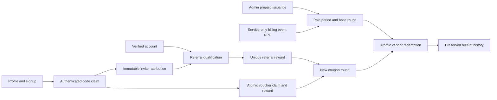

# Invite codes, subscriptions, and coupon refresh

> Historical paid-model documentation. Superseded by [the free Rajagiri MVP](free-rajagiri-mvp.md) on 2026-10-09.

Implemented in Supabase and the mobile app on 2026-10-08. See [verification results](invites-subscriptions-verification.md) for tested behavior and remaining device/payment boundaries.

## Implemented product rules

- Each permanent account has a unique five-character uppercase invite code. The alphabet excludes ambiguous characters: `ABCDEFGHJKLMNPQRSTUVWXYZ23456789`.
- A new account may attach one inviter during signup or within seven days. Self-referral is rejected. A verified email or phone qualifies the referral.
- The **inviter** receives the refresh, provided they have an active subscription at qualification. The entrant does not receive a subscription from a personal invite.
- Each paid period grants one coupon per canonical vendor, shared across the vendor's offers and branches.
- A qualifying referral or refresh voucher opens a new coupon round. Previously consumed vendors become available again. Unused coupons do not accumulate.
- Refreshes retain the exact period expiry; there is no carryover or banking when the inviter lacks active access.
- There are at most five rewarded referrals per period. The policy is enforced in Postgres and displayed in Profile.
- A voucher refreshes the entrant's active subscription. Each account can use a voucher once, subject to its global claim limit, validity dates, and active state.
- Subscription periods use `[starts_at, ends_at)`, checked against server time. Administrators issue prepaid calendar months; subsequent months start after existing paid access.

These rules are working defaults. The provider, monthly price, and currency have not been selected; no automatic charge or card storage is implemented.

## Architecture

Supabase Auth identifies the caller. Authenticated PostgREST RPCs expose account benefits, code claims, and redemption. Postgres owns all entitlement decisions. The existing mobile providers display server state and refresh it on focus, foreground, and a foreground-only 30-second interval.

### Schema

| Object | Purpose and guarantees |
| --- | --- |
| `kouponly_invite_codes` | Unique code and unique owner. Deleted accounts leave reserved code tombstones. Existing valid profile codes are backfilled. |
| `referral_uses` | Existing one-inviter-per-account attribution, extended with qualification status, reason, time, and reward grant. Legacy rows are not rewarded again. |
| `kouponly_subscription_plans` | Current monthly plan name; no invented price. |
| `kouponly_subscriptions` | Account, plan, provider subscription reference, and cancellation-at-end flag. |
| `kouponly_subscription_periods` | Exact paid bounds, provider period key, revocation. Ownership FKs and account locks prevent cross-account or overlapping usable periods. |
| `kouponly_billing_events` | Unique provider/event key, payload-bound successful processing receipt. Refund-before-payment leaves a revoked period tombstone. |
| `kouponly_reward_grants` | One reward per source/account, attached to the beneficiary's period. |
| `kouponly_coupon_rounds` | One open round per period, ordered round number, at most one round per reward grant. |
| `redemptions` | Existing receipts preserved. New receipts include period, round, canonical vendor/offer, server time, and immutable title/vendor snapshot. Unique consumed vendor per round. |
| `kouponly_vouchers` / `kouponly_voucher_claims` | Digest-based code lookup, global count, one claim per account. Voucher locking prevents concurrent oversubscription. |
| `mutation_receipts` | Existing private table reused for payload-bound retries of claims, redemption, and voucher issuance. The issuing admin can replay the private issuance receipt to recover a timed-out voucher response. |
| `kouponly_code_attempts` | Ten code attempts per account per minute. Invalid attempts remain counted despite validation rollback. |
| `kouponly_referral_policy` | Seven-day entry window and five rewarded referrals per paid period. |

No vendor list is copied into every account. Active access plus the current round provides implicit vendor eligibility; consumed receipts mark used vendors. Redemption also checks current vendor and offer activity. History does not reset when a new round opens.

The private entitlement views bind to the deployed catalogue and role tables and retain dependencies through a table rename. This feature does not apply unrelated pending backend-renaming migrations.

### RPCs

- `kouponly_account_benefits()` returns the caller's code, subscription, current round, used vendor IDs, referral status/counts, and server time.
- `kouponly_claim_code(p_code, p_mutation_id)` derives the account from Auth; validates invite or voucher rules; atomically grants a round; returns updated benefits.
- `kouponly_redeem_coupon(p_offer_id, p_round_id, p_mutation_id)` validates current paid access and round, then consumes the shared vendor quota and returns a server receipt.
- `kouponly_is_benefits_admin()` checks the existing server role.
- `kouponly_admin_issue_month(p_email, p_reference)` issues or schedules one prepaid month. A reused reference cannot issue another period or target another account.
- `kouponly_admin_create_voucher(p_label, p_max_claims, p_ends_at, p_mutation_id)` returns a random voucher with retry-safe issuance.
- `kouponly_admin_revoke_period(p_period_id, p_reference)` revokes paid access without deleting history.
- `kouponly_apply_billing_event(p_event)` accepts server-authoritative paid/revoke/cancel events; execute permission is restricted to the service role.

New owner tables permit only the caller's reads. Clients cannot directly write periods, grants, rounds, vouchers, claims, or receipts, or execute internal reward helpers. The old redemption RPC rejects old clients rather than allowing them to bypass subscription and round checks.

Account locks serialize claim, refresh, billing, and redemption. Referral qualification locks both accounts in UUID order before single-account mutations; terminal or unverified referrals do not acquire another account lock inside a mutation. Voucher and billing-event locks protect global resources. Unique constraints provide a final concurrency guard.

## Mobile flow

Profile displays the assigned code, Copy, native Share, reward count, and Enter a code. Signup includes an optional invite field after email verification. A failed optional claim leaves the profile step recoverable; the user can correct or remove the code.

Code entry retains the draft and operation ID after a transport failure, displays server validation errors, and explains which account received the reward. Account switches clear drafts, benefits, and receipt state; responses from the previous account are ignored.

Manage Subscription displays actual paid access, expiry and round. Admin accounts without a student row can access Profile and Manage memberships after server role verification. Admins can issue prepaid months and create refresh vouchers. Sign-out is local to the device and proceeds if push-token cleanup fails.

The redemption screen confirms one coupon at the vendor and displays the immutable receipt. A failed subsequent refresh or analytics operation does not hide a successful redemption. History combines new receipts with existing transaction history and shows coupon status rather than a fictional paid amount.

Android subscription, payment, admin, code-entry, and redemption screens include the top safe-area inset. Payment actions sit immediately below the content, with scrolling and bottom insets.

## Operational boundaries

Automatic payment checkout, saved cards, provider webhook verification, durable failed-event inbox/reconciliation, provider product mapping, and store billing are not connected. These depend on the provider and price decision. The service-only event RPC is an entitlement primitive, not proof that a payment occurred.

The current usable subscription mode is administrator-issued prepaid access after an approved grant or externally confirmed payment. The Payment Methods page states that adding a card is unavailable. No card or bank data is stored.

Old app versions cannot use the new paid coupon system. Existing receipts remain readable, but existing unpaid accounts do not receive implicit paid access. Deploy the updated mobile app before offering paid membership to customers.
